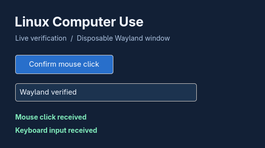
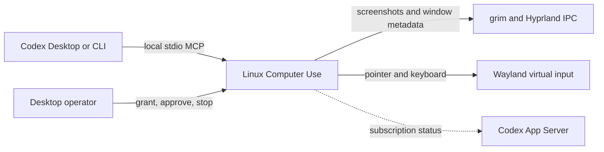

# Linux Computer Use

**"Because we Linux users don't sit around waiting for professionals to build what we want. We build it ourselves."**

[](LICENSE)


Give Codex local eyes and hands on a Hyprland desktop. Capture an application to verify a UI change, click or type in an approved window, and check the result. A desktop operator decides when access starts and can stop it at any time.

Linux Computer Use is an independent community project. It is unaffiliated with OpenAI.



*Live verification in an isolated application window. The screenshot contains only the disposable test fixture.*

## Capabilities

| Feature | What you can do |
| --- | --- |
| Screenshots | Capture the desktop, a named monitor, or an isolated application window. |
| Pointer and keyboard | Move, click, scroll, drag, type, and send a key chord. |
| Displays and windows | Inspect logical monitor geometry, find windows, focus or resize a window, and launch an installed desktop entry. |
| Accessibility and clipboard | Inspect supported AT-SPI elements. Read or replace clipboard text with separate approval. |
| Session controls | Check the active lease, revoke it immediately, and inspect the last redacted action result. |
| Codex usage | Read five-hour and weekly subscription allowance through the Codex App Server and save private milestone checkpoints. |

## Architecture



See [architecture and upstream sources](docs/architecture.md) for protocol choices and [verification](docs/verification.md) for tested behavior.

## Install

**Verified environment** — Arch Linux x86-64, Hyprland 0.57.2 on Wayland, Python 3.14, and local Codex Desktop and CLI. Python 3.12 or later is required. Other distributions, compositors, X11 and non-x86-64 architectures are untested. The included input installer targets x86-64 Linux.

On Arch, install the system dependencies if needed.

```sh
sudo pacman -S --needed base-devel python uv hyprland grim zenity wl-clipboard gtk3 wayland
```

The optional application and accessibility metadata providers use system PyGObject and AT-SPI. On Arch, install `python-gobject` and `at-spi2-core` for those features.

From the root of your cloned repository, install and register the server.

```sh
uv sync --locked
python install_input.py
mkdir -p native/build
native/build.sh native/build/drag
codex mcp add linux_desktop -- "$PWD/.venv/bin/python" "$PWD/launch.py"
codex mcp list
```

The installer verifies the separately downloaded input helper against pinned checksums. The server itself runs as your desktop user and opens no network listener.

Under the existing `[mcp_servers.linux_desktop]` table in your Codex configuration, forward the Wayland session variables. Add the separate per-tool table beneath the server configuration.

```toml
env_vars = [
  "XDG_RUNTIME_DIR",
  "DBUS_SESSION_BUS_ADDRESS",
  "XDG_CURRENT_DESKTOP",
  "XDG_SESSION_TYPE",
  "HYPRLAND_INSTANCE_SIGNATURE",
  "WAYLAND_DISPLAY",
]

[mcp_servers.linux_desktop.tools.desktop_status]
approval_mode = "approve"
```

Only the connection and lease status check receives this approval setting. Use a local Codex session with interactive approvals for protected tools. The desktop grant and confirmations still apply. Open a fresh local chat and invoke `linux_desktop.desktop_status`. A connected desktop with no operator lease reports `available: true` and `state: paused`. A hosted cloud chat may lack the local stdio connection. If a fresh desktop chat misses the server, use **Settings → MCP servers → Restart**.

## Use it

Start a time-limited grant from the checkout in a terminal on the target desktop.

```sh
python session.py grant observe --minutes 10
# Or start a control lease for input and window operations:
python session.py grant control --minutes 10
```

Accept the on-screen dialog and keep the access indicator open. Example prompts for Codex:

- “Use `linux_desktop` to inspect my test app. Capture its window and check whether the save button is visible.”
- “In the test window, click the input field and type ‘Wayland verified’. Ask for approval, then capture the window and check the result.”
- “Use `codex_usage_status` to check remaining subscription allowance.” Use Codex’s own `/status` for the active chat’s context.

To end the lease, select **Stop desktop access** on the indicator or run this from another terminal.

```sh
python session.py stop
```

## Permissions and limitations

- **Local consent.** Observation and control require a visible grant. Input and clipboard operations prompt for approval. An exclusive lock serializes desktop operations.
- **Minimal capture.** Prefer a window screenshot for private desktops. Isolated window capture requires recent grim with `-T` and a Hyprland stable window ID. The server refuses a desktop crop when isolated capture is unavailable.
- **Trust boundary.** The current Unix user and compositor are trusted. Other programs with existing access to the Wayland session are outside the bridge’s control. Treat captured text and visuals as untrusted input.
- **State changes.** Approval can include refocusing the exact target window. Input stops if the approved target changes or loses focus during execution. Mouse coordinates are in global logical units. Drag is limited to the left button within one target window.
- **Privacy.** Audit records contain time, action type, and result. The server keeps screenshot contents, clipboard data, typed text, and window titles out of its audit log. Screenshots returned to Codex follow your Codex session’s data handling.
- **Availability.** Accessibility depends on the toolkit and accessibility bus. App launch and resize depend on compositor and application support. Detached usage reads can report current context as unavailable.

## Contribute

Wayland users, bug reports and small pull requests are welcome. Include your compositor, tool versions, display scaling, and a reproduction against a disposable app. Keep screenshots and logs free of private content. Test permission changes in an isolated session before trying them on your desktop.

```sh
uv run --locked --no-sync python -m unittest discover -s tests -v
```

The opt-in `tests/headless_smoke.py` requires Bubblewrap, Sway 1.12 with wlroots 0.20, a GPU render node, GTK 4, system PyGObject, and Pillow. The [verification guide](docs/verification.md) describes its coverage.

[MIT license](LICENSE) · [Third-party notices](THIRD_PARTY_NOTICES.md) · [Release notes](CHANGELOG.md)
